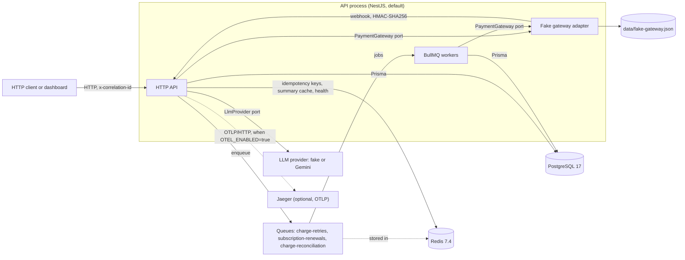
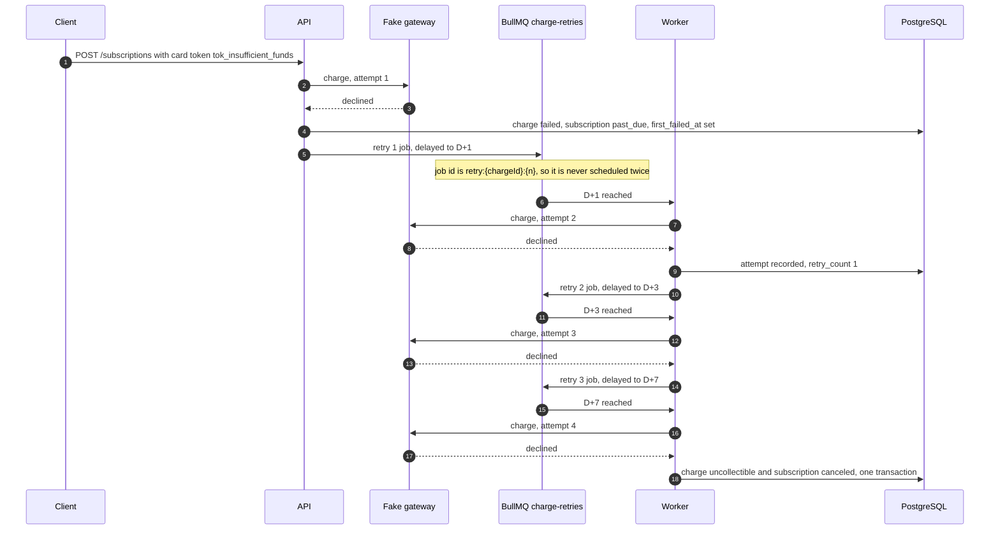

# subscription-payments-api

[](https://github.com/gusants/subscription-payments-api/actions/workflows/ci.yml)
[](https://github.com/gusants/subscription-payments-api/actions/workflows/ci.yml)

NestJS API that manages plans, customers and recurring subscriptions, and bills them against a payment gateway.

- Failed card charges and Pix/boleto expirations enter a dunning calendar (D+1, D+3, D+7) run by BullMQ; when retries run out the charge becomes `uncollectible` and the subscription is canceled.
- Gateway webhooks are HMAC-signed, verified and applied idempotently; `POST /subscriptions` and `POST /charges/{id}/retry` honour `Idempotency-Key`.
- `GET /metrics/overview` computes MRR, active and past-due subscriptions, delinquency rate and revenue by month; `GET /customers/{id}/summary` narrates a customer's payment history with an LLM, which never performs the calculations.

The payment gateway is a fake adapter behind a `PaymentGateway` port. Everything else (database, queues, webhooks, logs, tracing, LLM) is real.

## Contents

- [Architecture](#architecture)
- [Quick start](#quick-start)
- [Scripts](#scripts)
- [Endpoints](#endpoints)
- [Configuration](#configuration)
- [Technical decisions](#technical-decisions)
- [Metrics](#metrics)
- [Correlation id](#correlation-id)
- [Tracing](#tracing)
- [Webhooks](#webhooks)
- [Testing](#testing)
- [Following a payment in the logs](#following-a-payment-in-the-logs)
- [Live dashboard](#live-dashboard)
- [Demo](#demo)
- [Production changes](#production-changes)
- [Known limitations](#known-limitations)

## Architecture



The workers run in the API process by default (`WORKERS_ENABLED=true`). They can run in their own process (`pnpm start:worker`), but only with a real gateway: the fake gateway's JSON store is single-process.

### Dunning, end to end

A card that always declines (`tok_insufficient_funds`) walks the whole calendar:



Each retry is measured from the first failure, not chained from the previous retry. With `tok_fail_then_success` the retry is approved instead and the subscription returns to `active`. A Pix or boleto charge that expires is not retried in place: a new `pending` charge is issued for the same period, and after the third retry fails the subscription is canceled.

## Quick start

Requirements: Docker, Node.js 24 (`.nvmrc`) and pnpm 10 for the host-side commands. `scripts/demo.sh` also needs `curl` and `jq`.

### Option A: everything in Docker

```bash
cp .env.example .env
docker compose up --build
curl http://localhost:3000/health
```

This starts PostgreSQL, Redis and the API. The container applies migrations (`prisma migrate deploy`) on start and runs the workers in the same process. Swagger is at <http://localhost:3000/docs> and Bull Board at <http://localhost:3000/queues>.

Gaps before this is a literal single command:

- `.env` must exist first: compose reads `POSTGRES_USER`, `POSTGRES_PASSWORD` and `POSTGRES_DB` from it.
- The container does not seed data. Seeding needs the host toolchain (below).
- Compose forwards only the variables listed in `docker-compose.yml`. Settings such as `LLM_PROVIDER`, `GEMINI_API_KEY`, `RENEWAL_*` or `IDEMPOTENCY_*` in `.env` do not reach the container, so the API runs with their defaults.

### Option B: API on the host

```bash
cp .env.example .env
pnpm install
pnpm db:up
pnpm prisma:migrate
pnpm start:dev
```

`pnpm db:up` starts only PostgreSQL and Redis. `start:dev` does not run migrations, so `pnpm prisma:migrate` is required on a fresh database.

### Demo data and the demo script

With either option running (the compose file and `.env.example` both set `DEV_ROUTES_ENABLED=true`):

```bash
pnpm db:seed          # plans, customers and months of payment history
./scripts/demo.sh     # subscribe with a declining card, run the retry, summarise with AI, read metrics
```

`pnpm db:seed` refuses to run with `NODE_ENV=production` and uses `DATABASE_URL` from `.env`, which points at the PostgreSQL port published by compose. `scripts/demo.sh` reads `BASE_URL` (default `http://localhost:3000`) and fails with a clear message if `POST /dev/retries/run-now` answers 404 (dev routes off) or if the subscription does not become `active` within `POLL_TIMEOUT_SECONDS` (default 30).

## Scripts

| Command | What it does |
| --- | --- |
| `pnpm start:dev` | API in watch mode, with OpenTelemetry preloaded (inert unless `OTEL_ENABLED=true`) |
| `pnpm start` / `pnpm start:prod` | API from source / from `dist/` (after `pnpm build`) |
| `pnpm start:worker` / `pnpm start:worker:prod` | Workers only, as an application context with no HTTP server |
| `pnpm build` | Compiles to `dist/` |
| `pnpm db:up` / `pnpm db:down` | Starts / stops PostgreSQL and Redis with compose |
| `pnpm prisma:migrate` | `prisma migrate dev`: applies migrations and creates new ones |
| `pnpm prisma:generate` | Regenerates the Prisma client into `src/generated/prisma` |
| `pnpm db:seed` | Loads the demo data set into `DATABASE_URL` |
| `pnpm openapi:export` | Regenerates `openapi.json`; CI fails when the committed file is stale |
| `pnpm llm:smoke` | One real call to the Gemini provider (needs `LLM_PROVIDER=gemini` and `GEMINI_API_KEY`); not run in CI |
| `pnpm lint` / `pnpm format:check` / `pnpm typecheck` | oxlint (type-aware), Prettier check, `tsc --noEmit` |
| `pnpm test` / `pnpm test:cov` | Unit tests / unit tests with coverage thresholds |
| `pnpm test:integration` | Repository, queue and cache tests against Testcontainers |
| `pnpm test:e2e` | HTTP flows against Testcontainers |

## Endpoints

No endpoint has authentication (see [Production changes](#production-changes)). The only guarded route is `POST /webhooks/gateway`, which checks the gateway signature.

Interactive reference: `GET /docs` (Swagger). Machine-readable: [`openapi.json`](openapi.json), committed at the repository root.

| Method | Path | Notes |
| --- | --- | --- |
| POST | `/plans` | Create plan (`amountCents`, `interval` `monthly` or `yearly`) |
| GET | `/plans` | List plans |
| POST | `/customers` | Create customer |
| GET | `/customers` | List customers (search, status filter, pagination) |
| GET | `/customers/{id}` | Customer detail |
| GET | `/customers/{id}/charges` | Charge history with attempts |
| GET | `/customers/{id}/summary` | AI summary of payment behaviour (cached per customer event) |
| POST | `/subscriptions` | Create subscription; accepts `Idempotency-Key`; card, Pix or boleto |
| GET | `/subscriptions/{id}` | Subscription detail |
| POST | `/subscriptions/{id}/cancel` | Immediate cancellation (no cancel-at-period-end) |
| POST | `/charges/{id}/retry` | Manual retry or reconciliation; accepts `Idempotency-Key`; answers `202`, `200`, `409` or `503` |
| POST | `/webhooks/gateway` | Gateway events; requires `x-gateway-signature`; tag `webhooks` |
| GET | `/metrics/overview` | `from` and `to` (both or neither); see [Metrics](#metrics) |
| GET | `/health` | Postgres and Redis; `503` when either is down |
| POST | `/dev/retries/run-now` | Promotes every delayed retry job; `404` unless `DEV_ROUTES_ENABLED` |
| POST | `/fake-gateway/reset` | Clears the fake gateway store; `404` unless `FAKE_GATEWAY_ROUTES_ENABLED` |
| POST | `/fake-gateway/charges/{id}/pay` | Settles a pending Pix or boleto at the gateway |
| POST | `/fake-gateway/charges/{id}/expire` | Expires a pending Pix or boleto at the gateway |
| POST | `/fake-gateway/subscriptions/{id}/card` | Replaces the card token of a card subscription (`{ "cardToken": "tok_..." }`) |

Bull Board is served at `/queues` (not in Swagger or `openapi.json`), enabled by `BULL_BOARD_ENABLED`.

Example, illustrative of the response shape (values are placeholders):

```bash
curl -s -X POST http://localhost:3000/subscriptions \
  -H 'Content-Type: application/json' \
  -H "Idempotency-Key: $(uuidgen)" \
  -d '{"customerId":"cus_...","planId":"plan_...","paymentMethod":"card","cardToken":"tok_success"}'
```

Retry the same request with the same key and the stored response is replayed with `Idempotent-Replayed: true`.

## Configuration

Variables are validated at startup from `src/shared/config/env.schema.ts`; an invalid value stops the process. `.env.example` lists them with the development values. Tracing variables are read before Nest starts from the same rules and are covered in [Tracing](#tracing).

| Variable | Default | Purpose |
| --- | --- | --- |
| `NODE_ENV` | `development` | `development`, `test` or `production`; drives the defaults of the dev flags below |
| `PORT` | `3000` | HTTP port |
| `LOG_LEVEL` | `info` | Pino level |
| `DATABASE_URL` | required | PostgreSQL URL |
| `REDIS_HOST` / `REDIS_PORT` | required / `6379` | Redis for queues, idempotency, cache and health |
| `PAYMENT_GATEWAY` | `fake` | Gateway adapter (only `fake` exists) |
| `FAKE_GATEWAY_DATA_FILE` | `data/fake-gateway.json` | JSON store of the fake gateway |
| `FAKE_GATEWAY_ROUTES_ENABLED` | `true` outside production | Mounts `/fake-gateway/*` |
| `FAKE_GATEWAY_PIX_EXPIRATION_SECONDS` | `1800` | Pix expiry |
| `FAKE_GATEWAY_BOLETO_EXPIRATION_SECONDS` | `259200` | Boleto expiry (3 days) |
| `FAKE_GATEWAY_EXPIRATION_SWEEP_INTERVAL_MS` | `5000` | Expiry sweep; `0` disables it |
| `FAKE_GATEWAY_WEBHOOK_URL` | `http://localhost:$PORT/webhooks/gateway` | Where the fake gateway delivers events |
| `FAKE_GATEWAY_WEBHOOK_DELAY_MS` | `500` | Delay before each webhook |
| `FAKE_GATEWAY_DUPLICATE_WEBHOOK_RATE` | `0` | Probability (0 to 1) of re-sending an event |
| `FAKE_GATEWAY_WEBHOOK_DISPATCH_ENABLED` | `true` | `false` stores events without delivering them |
| `GATEWAY_WEBHOOK_SECRET` | required, 32+ chars | HMAC key for webhooks, shared by the fake gateway and the API |
| `RETRY_INTERVAL_UNIT` | `days` | `minutes` compresses the dunning calendar; refused in production |
| `ALLOW_ACCELERATED_RETRIES` | unset | Must be `true` to boot with `RETRY_INTERVAL_UNIT=minutes` in production |
| `WORKERS_ENABLED` | `true` | `false` makes the process enqueue only |
| `RENEWAL_JOB_INTERVAL_SECONDS` | `3600` (days) / `30` (minutes) | Renewal sweep period |
| `RENEWAL_BATCH_SIZE` | `100` (max 1000) | Subscriptions per renewal sweep |
| `RECONCILIATION_JOB_INTERVAL_SECONDS` | `300` (days) / `30` (minutes) | Reconciliation sweep period |
| `RECONCILIATION_STALE_AFTER_MINUTES` | `5` | Age before a pending charge or due retry is reconciled |
| `RECONCILIATION_BATCH_SIZE` | `100` (max 1000) | Rows per sweep and per kind |
| `CHARGE_ATTEMPT_LEASE_SECONDS` | `30` | How long an in-flight charge attempt blocks a retry |
| `DEV_ROUTES_ENABLED` | `true` outside production | Mounts `POST /dev/retries/run-now` |
| `BULL_BOARD_ENABLED` | `true` outside production | Mounts `/queues` |
| `IDEMPOTENCY_TTL_SECONDS` | `86400` | Lifetime of a completed idempotent response |
| `IDEMPOTENCY_LOCK_TTL_SECONDS` | `60` | Lock of an in-flight request; heartbeated while it runs |
| `LLM_PROVIDER` | `fake` | `fake` (no network) or `gemini` |
| `LLM_MODEL` | `gemini-3.5-flash-lite` | Model name for the provider |
| `LLM_TIMEOUT_MS` | `8000` | Timeout per model call |
| `LLM_THINKING_LEVEL` | `minimal` | `minimal`, `low`, `medium` or `high` (Gemini) |
| `LLM_MAX_CALLS_PER_MINUTE` | `60` | Per-process token bucket for model calls |
| `GEMINI_API_KEY` | required when `LLM_PROVIDER=gemini` | Gemini API key |
| `CUSTOMER_SUMMARY_CACHE_TTL_SECONDS` | `86400` | TTL of LLM summaries |
| `CUSTOMER_SUMMARY_FALLBACK_TTL_SECONDS` | `30` | TTL of fallback summaries |
| `CUSTOMER_SUMMARY_MEMORY_CACHE_MAX_ENTRIES` | `500` | In-process cache used when Redis is down |
| `OTEL_ENABLED` | `false` | Turns OpenTelemetry tracing on |
| `OTEL_SERVICE_NAME` | `subscription-payments-api` | `service.name` of the spans |
| `OTEL_EXPORTER_OTLP_ENDPOINT` | SDK default (`http://localhost:4318`) | OTLP/HTTP collector |

Logs are JSON through Pino. Pino redacts `authorization`, `cookie`, `x-gateway-signature` and `idempotency-key` headers, and the fields `cardToken`, `token` and `email` at the top level of a log object or up to two levels below it. Query string values are never logged (`req.url` becomes `/customers?[Redacted]`). Paths are logged as they are, so never put personal data in a path segment. The rules live in `src/shared/logging/redact-paths.ts` and `src/shared/logging/request-serializer.ts`.

## Technical decisions

**The gateway is a port.** `PaymentGateway` (`src/gateway/payment-gateway.port.ts`) is implemented by a fake adapter that keeps customers, charges and events in a JSON file and delivers signed webhooks. Replacing it means writing one adapter; the billing rules do not change.

**Idempotency at the HTTP boundary.** `POST /subscriptions` and `POST /charges/{id}/retry` accept `Idempotency-Key`. The key is scoped to method, resolved path and key, and the body is fingerprinted in canonical form, so key order does not matter. The lock is taken with a Lua script and carries a token, so exactly one concurrent request wins and an expired lock cannot overwrite a newer one. Completed `2xx` responses and definite `404`, `409` and `422` are stored; validation errors, `5xx` and transient conflicts are not, so the client can retry. Same key with a different body is `422`; same key while the first request runs is `409`.

**Charges are committed before they are scheduled.** Settlements commit first and the next retry is enqueued afterwards, never inside a database transaction. If the enqueue fails, the settlement stays and the missing retry is recovered by `POST /charges/{id}/retry` or by reconciliation. The charge row (`first_failed_at`, `retry_count`) is the persisted record of what is owed.

**Dunning is scheduled business time; BullMQ retries are technical.** Retries at D+1, D+3 and D+7 from the first failure are delayed jobs with the id `retry:{chargeId}:{n}`, so scheduling the same retry twice yields one job. BullMQ `attempts` and exponential backoff (5 attempts, 5 s base) are used only for `GatewayUnavailableError`, which records no payment attempt and does not move the dunning calendar. A `GatewayOutcomeUnknownError` is not retried blindly: the charge stays `pending` and is resolved by asking the gateway about its attempt key.

**Attempt keys make re-sends safe.** Every gateway attempt uses the key `<chargeId>:<attemptNumber>`, persisted before the gateway is called. A re-send with the same key cannot charge twice; reconciliation asks the gateway for that key first.

**One live charge per period.** A partial unique index on `charges (subscription_id, period_start) WHERE status <> 'expired'` makes a period have at most one live charge, so Pix and boleto reissues and renewal sweeps cannot duplicate a period. The index is declared only in migration `20261109120000_dunning_state_and_partial_period_unique`, because Prisma 7 needs a preview feature this project does not enable. Do not recreate it from `schema.prisma`; an integration test checks the predicate in `pg_indexes`.

**Webhooks are verified on raw bytes and applied once.** The HMAC is computed over the raw request body with a constant-time comparison; timestamps more than 5 minutes off are rejected (`401`). Each event is inserted into `webhook_events` (unique `gateway_event_id`) in the same transaction that locks the charge and applies the effect. Duplicates answer `200` and do nothing.

**Correlation id as a search key.** Every charge stores the id it was created under, and every job, webhook and manual retry switches to it. This follows one payment across HTTP, queues and webhooks. It is not authentication: a client may choose any well-formed id.

**Metrics are pure functions.** MRR, delinquency and revenue are computed by functions in `src/modules/metrics/domain/` that are unit-tested without a database; the repository only loads the inputs.

**The LLM narrates; it does not decide.** `GET /customers/{id}/summary` works like this:

- Numbers (`monthsAsCustomer`, `totalPaidCents`, `failedAttempts`, `averageDaysLate`, `paymentSuccessRate`) are computed in code and returned as is.
- The model receives an anonymized context: plan, metrics and a timeline by billing period, with ISO UTC dates. No name, e-mail, document, real id or pseudonym of an id.
- The reply must match a Zod schema (`summary`, `paymentBehavior`, `riskLevel`, `suggestedAction`). Any number in the narration must derive from the context, otherwise the narration is discarded.
- Any provider error, timeout, truncated reply or invalid output yields a deterministic rules-based summary with `source: "fallback"`. The endpoint does not return 5xx because of the LLM.
- The model has no tools and cannot cancel, block or charge anything.
- The cache key is `customer-summary:{customerId}:{promptVersion}:{model}:{lastEventId}`, where `lastEventId` changes with any payment, attempt, status change, plan price change or completed month of tenure. Concurrent requests share one model call (in-process single-flight plus a Redis `SET NX` lock).
- The prompt is versioned in `src/llm/prompts/` (`customer-summary.v2.md`, returned as `promptVersion`).

## Metrics

`GET /metrics/overview?from=YYYY-MM-DD&to=YYYY-MM-DD` (or ISO datetimes; both or neither; at most 366 days). Without parameters the period is the current UTC calendar month.

- **MRR** (`monthlyRecurringRevenueCents`): the sum over plans of `amountCents` × active subscriptions for monthly plans, plus the yearly total ÷ 12, rounded once. It uses each plan's current `amountCents`, not the amount each subscription was billed at.
- **`activeSubscriptions`, `pastDueSubscriptions`**: current counts by status; not filtered by the period.
- **Delinquency rate** (`delinquencyRate`), a fraction between 0 and 1:

  ```
  delinquencyRate = (pastDue + canceledForPaymentFailure) / (active + pastDue + canceledForPaymentFailure)
  ```

  `canceledForPaymentFailure` counts subscriptions with `status = canceled`, `cancel_reason = payment_failed` and `canceled_at` inside the period. The rate is `null` when the denominator is 0.
- **`revenueByMonth`**: the sum of `amount_cents` of `paid` charges by `paid_at` month (UTC), inside the period.
- **`subscriptionsByStatus`**: current counts for every status.

The formula is implemented in `src/modules/metrics/domain/delinquency-rate.ts`.

## Correlation id

Every HTTP response carries an `x-correlation-id` header. A client may send its own (8 to 128 characters from `A-Z a-z 0-9 . _ -`) and it is reused; a missing or malformed value is replaced with a generated `cor_<ulid>`. The id lives in an `AsyncLocalStorage` context (`src/shared/correlation/`) and Pino writes it as `correlationId` on every line of the request, including `request completed`.

Charges record the id they were created under in `charges.correlation_id`. A dunning reissue inherits the id of the charge it replaces; a renewal starts a new one. Retry job data carries the id, and the worker processes the job within it. The id is never part of the job id, so jobs deduplicate regardless of the id.

Payment milestones are logged as structured events with a fixed `event` field (`src/modules/charges/payment-events.ts`): `charge.created`, `charge.attempt.failed`, `charge.retry.scheduled`, `charge.paid`, `charge.expired`, `charge.refund_required`, `charge.dunning_exhausted`, `subscription.status_changed`, `webhook.received` and `webhook.duplicate_ignored`. They are written once, after the change they describe is committed.

## Tracing

OpenTelemetry is off by default and costs nothing while off. When on (`OTEL_ENABLED=true`), the SDK exports spans over OTLP/HTTP and instruments HTTP, Express, `pg` and `ioredis` (the last two only inside traced operations). BullMQ jobs are traced by hand: publishing a job opens a producer span and stores its W3C context in the job; the worker opens a consumer span. A dunning retry, published with a delay of days, runs in its own trace linked to the publish span, so a request trace does not stay open for a week. Log lines carry `trace_id` and `span_id` while a span is active.

Jaeger runs behind the `observability` compose profile:

```bash
OTEL_ENABLED=true docker compose --profile observability up --build
open http://localhost:16686
docker compose --profile observability down
```

With the API on the host, start only the dependencies with `docker compose --profile observability up -d postgres redis jaeger` and run `OTEL_ENABLED=true pnpm start:dev`.

## Webhooks

`POST /webhooks/gateway` answers `200 { "received": true }` once the event is processed. It is internal to the gateway integration and tagged `webhooks` in Swagger.

- Header: `x-gateway-signature: t=<unix seconds>,v1=<hex HMAC-SHA256 of "<t>." + raw body>`, keyed with `GATEWAY_WEBHOOK_SECRET`.
- Missing or invalid signature, or a timestamp outside the 5-minute window: `401`. A valid signature over a body that is not a gateway event: `400`.
- The charge is resolved by `data.charge.externalRef`. Each event is recorded in `webhook_events` with an `outcome`:

| Event | Charge state | Outcome |
| --- | --- | --- |
| any | unknown charge | `ignored_unknown_charge` |
| any | amount or customer differs from ours | `rejected_mismatch`, logged at ERROR |
| `charge.paid` | `pending` | `applied`: charge `paid`, subscription to `active` |
| `charge.paid` | `pending` on a canceled subscription | `applied`, logged at ERROR: a refund is due |
| `charge.paid` | already `paid` with the same gateway charge | `ignored_duplicate_state` |
| `charge.paid` | `expired`, `failed`, `uncollectible`, or a different gateway charge | `requires_refund`, logged at ERROR |
| `charge.failed` | `pending` | `applied`: charge `failed`, subscription `past_due` |
| `charge.expired` | `pending` | `applied`: charge `expired`; a first charge cancels the subscription, a renewal makes it `past_due` |
| any other | any other state | `rejected_out_of_order`, logged at WARN |

Refunds are not implemented; a `requires_refund` outcome is a log signal, not an action.

## Testing

| Layer | Files | Command | Needs |
| --- | --- | --- | --- |
| Unit | `src/**/*.spec.ts` | `pnpm test` | nothing |
| Coverage | same | `pnpm test:cov` | fails below 80% lines, branches, functions and statements globally, and below 90% in `src/modules/**/domain/**` |
| Integration | `test/integration/*.integration-spec.ts` | `pnpm test:integration` | Docker: PostgreSQL 17 and Redis 7.4 via Testcontainers, migrations applied |
| End-to-end | `test/e2e/*.e2e-spec.ts` | `pnpm test:e2e` | Docker: the full app through Supertest, same containers |

Testcontainers starts its own databases; no compose stack is needed. Domain rules are tested as pure functions in the unit layer; the integration layer checks repositories, Redis scripts and the partial index; the e2e layer covers the journeys (subscription, dunning recovery, reconciliation, webhooks, idempotency, summary, metrics).

CI (`.github/workflows/ci.yml`) runs on push and pull request. The `quality` job runs lint, format check, typecheck, unit tests with coverage, integration, e2e, build, and a check that `openapi.json` is up to date. On push to `main` a second job publishes the coverage badge JSON to the `badges` branch, which the badge above reads. The badge shows line coverage.

## Following a payment in the logs

[`docs/observability.md`](docs/observability.md) walks through one payment from the first request to the webhook that confirms it, with the filter commands and the trace view.

## Live dashboard

TODO: add the link to the live demo of the dashboard (Project 2). No URL is defined yet.

## Demo

TODO: record the demo GIF and save it as `docs/demo.gif`. The file does not exist yet.

## Production changes

- **Payment gateway.** Replace the fake adapter with a real `PaymentGateway` implementation. The fake gateway's JSON store is single-process, so the workers must then be able to run in a separate process. Refunds are not implemented.
- **Authentication and authorization.** No route is authenticated, including `/docs`, `/queues` (Bull Board, which shows and can act on jobs), `/dev/*`, `/fake-gateway/*`, customer data and the summary endpoint that triggers LLM calls. Put the API behind an authenticating gateway and keep the dev and fake gateway routes off.
- **Rate limits.** No HTTP rate limit. The LLM bucket is per process, so N instances make up to N times `LLM_MAX_CALLS_PER_MINUTE` calls.
- **Secrets.** `GATEWAY_WEBHOOK_SECRET`, `GEMINI_API_KEY` and database credentials come from `.env` in this repository. Use a secret manager. The values in `.env.example` are development values.
- **Demo flags in production.** `RETRY_INTERVAL_UNIT=minutes` (with `ALLOW_ACCELERATED_RETRIES=true`), `BULL_BOARD_ENABLED`, `DEV_ROUTES_ENABLED` and `FAKE_GATEWAY_ROUTES_ENABLED` are set by the compose file for the demo. Production must not use them.
- **Data retention and privacy.** Customer names and e-mails, webhook events, payment attempts and failed jobs are kept indefinitely; there is no deletion or export endpoint, which LGPD requests will need. Logs are written to stdout; there is no shipping or retention configuration.
- **Queues and Redis.** One Redis instance holds the queues, idempotency keys and summary cache, with `noeviction` and AOF in compose. A managed Redis with persistence and failover is needed. Completed jobs are kept for 1000 entries or 24 hours; failed jobs are kept until someone removes them.
- **Time zones and multi-region.** The project has no time zone setting: metrics months and summary timelines are UTC. Multi-region deployment is not designed; the renewal and reconciliation sweeps assume one shared Redis and database.
- **Schema.** The partial unique index is outside Prisma's schema (see [Technical decisions](#technical-decisions)).

## Known limitations

- Only the fake gateway exists; it stores data in a local file and delivers webhooks with a timer.
- Cancellation is immediate; there is no cancel-at-period-end.
- Metrics are computed on request from the tables; there is no pre-aggregation.
- `activeSubscriptions` and `pastDueSubscriptions` are current counts, while the cancellations in the delinquency rate are bounded by the requested period.
